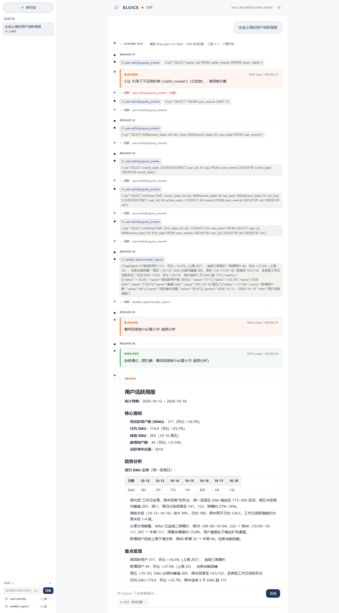
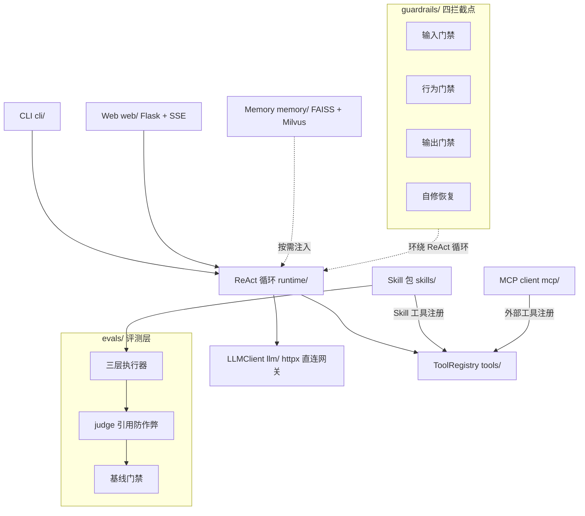

<div align="center">

# Sluice

**可挂载 Skill 的数据 Agent 平台 —— AI 帮你查数出报告，且它的产出你敢信**

[](https://github.com/JohnnyQ-commits/sluice-data-agent/actions/workflows/ci.yml)
[](pyproject.toml)
[](LICENSE)
[](#快速体验)

**[快速体验 ↓](#快速体验)** &nbsp;·&nbsp; **[架构](#架构)** &nbsp;·&nbsp; **[Skill 包协议](#skill-包协议)** &nbsp;·&nbsp; **[与同类项目的差异](#与同类项目的差异)**



*Web 界面实录：`sluice run "生成本周销售周报"` 的真实轨迹——第 1 轮 SQL 出错（红色观察），模型依据反馈调整口径，第 3 轮起产出正确的统计查询。*

</div>

---

## 一分钟看到它工作

用一句自然语言提数据需求，AI Agent 自己规划步骤、生成 SQL、查数据库、产出格式完整的报告。而当 AI 犯错时——引用不存在的表、陷入重复调用、报告缺章节——门禁当场拦截并引导自纠：

```text
$ python scripts/demo_guardrails.py        # 零 API key，clone 即可运行

--- 第一幕：幻觉工具拦截 ---
[模型]   调用 ghost_tool（一个不存在于注册表的工具）
[输入门禁] ✗ 拦截：工具 ghost_tool 不在注册表中（幻觉工具），调用被拦截
[模型]   收到，改用注册表内的工具...

--- 第二幕：重复调用打断 ---
[模型]   调用 demo.report → done
[模型]   再次调用 demo.report
[行为门禁] ✗ 打断：检测到与上一轮完全相同的重复调用，请换方法推进或直接给出最终回答

--- 第三幕：产出契约自修 ---
[输出门禁] ✗ 最终回答缺少必需小节: 核心指标、重点发现
[自修恢复] ✓ 定向自修通过，补齐契约后重新交付
[最终]   ## 核心指标  总申请量 1,234 件  ## 重点发现  通过率环比上升

--- 审计落盘 --- audit/audit.jsonl
```

以上是门禁层的确定性演示（不调用大模型）。配置 LLM 后解锁完整链路：`sluice run "生成本周销售周报"` → Agent 真查 demo 库、流式输出带真实数字的周报；Web 界面里还能看到轨迹逐轮滚动、拦截以琥珀色卡片呈现。

## 这是什么

**Sluice 是一个数据 Agent 运行时（harness）。** 它干两件事：

1. **让 Agent 干活**：ReAct 循环 + 工具生态（内置 SQLite 查询、可接 MCP server）+ 本地 Web 界面。业务以 Skill 包形式挂载——数据周报是第一个乘客，写一个三件套（`SKILL.md` + `tools.py` + `evals/`）就能挂载新场景，平台能力（门禁、评测、审计、记忆）全部自动生效
2. **让产出可信**：AI 查数产品的通病是"一本正经地胡说"。Sluice 在循环四个位置埋门禁（工具调用前 / 循环中 / 交付前 / 恢复），评测层用 LLM-as-judge 且**每个评分必须引用产出原文逐字佐证**，基线门禁守住质量不回退，审计 JSONL 留痕每一次拦截与自修

能力是"会调 API"，可信是工程问题——Sluice 做的是后者。

## 快速体验

```bash
git clone https://github.com/JohnnyQ-commits/sluice-data-agent.git
cd sluice-data-agent
pip install -e ".[dev]"
```

**第一档：不需要任何 API key**（演示门禁层与评测层，全为确定性代码）：

```bash
python scripts/demo_guardrails.py    # 上面展示的三幕演示
sluice eval --all --skip-judge       # 三层评测跑一遍
pytest tests/ -q                     # 317 个测试全部零 key 可跑
```

**第二档：配置 LLM 解锁完整体验**（任意 Anthropic Messages 兼容端点）：

```bash
cp .env.example .env                 # 填 SLUICE_LLM_BASE_URL / SLUICE_LLM_API_KEY / SLUICE_LLM_MODEL

sluice run "生成本周销售周报"         # 终端看完整 ReAct 轨迹
sluice web                           # 本地 Web 界面（Flask + SSE）
sluice eval --all                    # 完整评测含 judge 打分
```

> 界面上值得试的一手：故意问一个**不存在的表**（如"查一下 user_behavior 表近 7 天活跃用户"），看 AI 的错误尝试被琥珀色卡片当场接住，随后靠拦截反馈自纠、改用真表出数。

## 核心特性

- **ReAct 循环 + 四拦截点** —— 工具调用前 / 循环运行中 / 产出交付前 / 恢复策略，门禁内建于发动机；`guardrails=None` 一键回到裸循环
- **Skill 包协议** —— 三件套挂载即获得评测与门禁，业务无关运行时
- **LLM-as-judge 防作弊** —— 评分必须逐字引用产出原文，引用比对不过判分无效：评测工具本身也不可被骗
- **基线回归门禁** —— 通过率或 judge 均分对比基线下降即失败，消失的 Skill 显式报错
- **零官方 LLM SDK** —— httpx 直连网关，function calling 手写实现，行为完全可读
- **零官方 SDK 的 MCP client** —— protocol / transport / registry 三件套自实现（见[下文](#mcp-生态)）
- **长期记忆** —— FAISS 本地向量检索，可选 Milvus 后端，默认关闭零行为变化
- **零 API key 全量测试** —— 317 个测试，CI 持续验证

## 架构



| 模块 | 职责 |
|------|------|
| `llm/` | httpx 直连 Anthropic Messages 兼容网关，超时重试与 function calling 自实现 |
| `tools/` | 原子工具与注册表（SQLite 查询等），Skill 工具与 MCP 工具共用一个 registry |
| `skills/` | Skill 包加载器 + 两个内置示例（`weekly-report`、`user-activity`） |
| `runtime/` | ReAct 循环发动机：多轮思考→行动→观察、轨迹记录、异常分类与自修恢复 |
| `guardrails/` | 四拦截点编排：输入门禁（幻觉工具/非法参数/越权表）、行为门禁（重复调用/预算）、输出门禁（契约校验）、自修恢复 |
| `evals/` | 三层执行器（门禁剧本 / 单轮行为 / 端到端产出）+ judge + 基线门禁 |
| `mcp/` | 零官方 SDK 的 MCP client 三件套，读 `.mcp.json` 发现并调用外部工具 |
| `memory/` | 会话记忆与长期记忆（FAISS 本地检索，可选 Milvus），默认关闭 |
| `web/` / `cli/` | Flask + SSE 的本地界面；`run` / `web` / `eval` / `mcp` 四个子命令 |

## 与同类项目的差异

[WrenAI](https://github.com/Canner/WrenAI)、[DB-GPT](https://github.com/eosphoros-ai/DB-GPT)、[Vanna](https://github.com/vanna-ai/vanna) 是数据 Agent 领域的头部开源项目——它们做的是**面向最终用户的 BI 产品 / Text-to-SQL 引擎**（语义层、仪表盘、图表、多数据源接入）。Sluice 与它们不竞争，处在不同的层：

| | WrenAI / DB-GPT / Vanna | Sluice |
|---|---|---|
| 定位 | GenBI 产品与 Text-to-SQL 引擎 | Agent 运行时（harness） |
| 回答的问题 | "怎么把问题变成 SQL" | "SQL 变错了怎么兜住" |
| 核心资产 | 语义层 / 可视化 / 连接器 | 四拦截点门禁 / 防作弊评测 / 审计 |
| 使用方式 | 部署即用的应用 | 挂载 Skill 包的运行时，业务可替换 |

一句话：**它们把治理做在平台侧（语义层、审批流、权限配置），Sluice 把可靠性做进运行时（循环内四个拦截点）且可评测验证**——跑 `sluice eval` 有基线为证；两者路径不同，可以组合（例如给某个问数引擎配上 Sluice 的门禁与评测层）。

## Skill 包协议

一个 Skill 包 = 三件套，目录名即 Skill 名：

```
skills/weekly-report/
├── SKILL.md        # frontmatter: name / description / output_contract（产出契约小节清单）+ 正文写死统计口径与使用流程
├── config.yaml     # Skill 包配置
├── tools.py        # Skill 专属工具，函数名以 {skill}.{tool} 前缀注册进 ToolRegistry
└── evals/
    └── cases.py    # 三层评测用例：产出断言 / 行为断言 / 门禁
```

平台对挂载的 Skill 兑现三件事：工具进 registry 参与 ReAct 循环；`SKILL.md` 的 `output_contract` 自动成为产出交付前的门禁校验项；`evals/cases.py` 被 `sluice eval` 纳入三层评测与基线门禁。

参考实现：[`skills/weekly-report/`](skills/weekly-report/)。

## MCP 生态

Sluice 不锁工具生态：stdio 接入任意 MCP server，工具以 `mcp__<server>__<tool>` 命名挂进 ReAct 循环与 `sluice mcp`，公共 server 开箱即用。仓库提供 `.mcp.json.example`（公共 filesystem server，复制为 `.mcp.json` 即生效）：

```json
{
  "mcpServers": {
    "filesystem": {
      "command": "cmd",
      "args": ["/c", "npx", "-y", "@modelcontextprotocol/server-filesystem", "examples"],
      "timeout": 120
    }
  }
}
```

实测两条命令（Windows 下 Popen 不解析 `npx` 的 `.cmd` shim 故包一层 `cmd /c`，POSIX 直接写 `"command": "npx"`；`timeout` 需覆盖 npx 冷启动的 30s+）：

```bash
sluice mcp   # 列出 14 个工具（read_file / edit_file / directory_tree / ...）
sluice mcp --call mcp__filesystem__read_file --args '{"path": "langgraph_weekly/README.md"}'
```

也可以先试仓库自带的最小 echo server（无需 npm）：把下面配置存为 `.mcp.json`，即可 `sluice mcp --call mcp__echo__echo --args '{"text": "hi"}'`：

```json
{
  "mcpServers": {
    "echo": {
      "command": "python",
      "args": ["tests/fixtures/mini_mcp_server.py"],
      "timeout": 30
    }
  }
}
```

## 为什么自研 harness（而不是 LangChain）

生产命门在框架黑盒里拿不到：guardrails 该在循环的哪几个点拦截、LLM 异常如何分类并决定重试还是放弃、评测怎么做才能既确定性又防作弊——这些是可靠性问题的答案本身，而不是框架的配置项。拿不到控制点，就只能围着别人的抽象打补丁。

我们不排斥框架，而是先验证了边界：`examples/langgraph_weekly/` 是同一个周报 Skill 的 LangGraph 对比移植，可以逐行对比两边各控制住了什么、让渡了什么。

## Status

**alpha**。核心闭环、可靠性、评测、生态四层均已落地并有全量测试（317 tests）与 CI 门禁，API 仍可能变化。

工程过程即文档：`docs/plans/` 保留 P0–P5 六个阶段的完整实现计划（含执行红线），可以完整复盘每一层是怎么一步步建起来的。

## License

[MIT](LICENSE)
