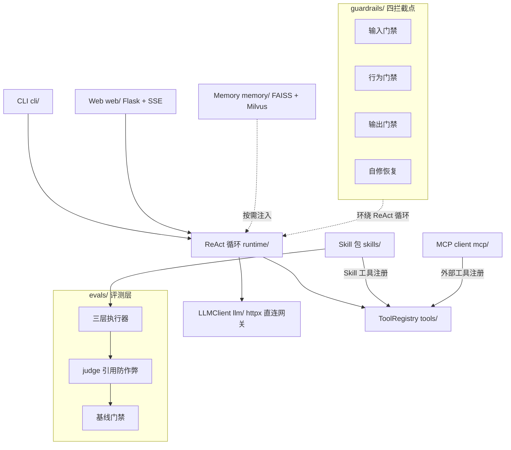

# Sluice

**可挂载 Skill 的数据 Agent 平台——AI 帮你查数出报告，且它的产出你敢信**

[](https://github.com/JohnnyQ-commits/sluice-data-agent/actions/workflows/ci.yml)
[](pyproject.toml)
[](LICENSE)
[](#status)

## 这是什么

你用一句自然语言提出数据需求，AI Agent 自己规划步骤、生成 SQL、查数据库、产出格式完整的报告：

```bash
sluice run "生成本周销售周报"
# Agent 轨迹：理解需求 → 生成 SQL → 查 demo 库 → 流式输出带真实数字的周报
```

这类"AI 查数"的 demo 满街都是，Sluice 解决的是它们普遍的死穴：**AI 会一本正经地胡说**——引用不存在的表、数字来源不明、陷入重复调用。Sluice 在 Agent 循环的四个位置埋了门禁，错误尝试被当场拦下并回喂给模型自纠；每个 Skill 自带评测用例与基线门禁，质量回退在 CI 就被拦住；全程审计留痕，每一次拦截与自修都可复查。

它同时是一个**平台**而不是单个 Agent：数据周报只是挂载的第一个 Skill 包。写一个满足[包协议](#skill-包协议)的三件套（`SKILL.md` + `tools.py` + `evals/`），就能挂载一个新业务场景，获得平台全部能力——门禁、评测、审计、记忆、工具生态。仓库内置两个示例 Skill（销售周报、信贷周报），后者与前者共享同一个运行时，仅是多挂了一个包。

## 快速体验

```bash
git clone https://github.com/JohnnyQ-commits/sluice-data-agent.git
cd sluice-data-agent
pip install -e ".[dev]"
```

**第一档：不需要任何 API key，clone 即验**——演示的是门禁层（确定性代码，不调用大模型）：

```bash
# 三幕演示：幻觉表拦截 → 重复调用打断 → 产出契约自修，30 秒看到门禁真实工作
python scripts/demo_guardrails.py

# 评测三层跑一遍（确定性层全过，279 个测试同理零 key 可跑）
sluice eval --all --skip-judge
pytest tests/ -q
```

**第二档：配置 LLM 后解锁完整体验**——Agent 真查库、真出报告（任意 Anthropic Messages 兼容端点）：

```bash
cp .env.example .env   # 填 SLUICE_LLM_BASE_URL / SLUICE_LLM_API_KEY / SLUICE_LLM_MODEL

sluice run "生成本周销售周报"   # 单次指令，终端看完整 ReAct 轨迹
sluice web                      # 本地 Web 界面（Flask + SSE），轨迹流式滚动 + 拦截卡片
sluice eval --all               # 完整评测含 LLM-as-judge 打分
```

界面上值得试的一手：故意问一个**不存在的表**（如"查一下 user_behavior 表近 7 天活跃用户"），你会看到 AI 的错误尝试被琥珀色拦截卡片当场接住，随后靠拦截反馈自纠、改用真表出数。

## 核心特性

- **ReAct 循环 + 四拦截点**：工具调用前 / 循环运行中 / 产出交付前 / 恢复策略，门禁全部内建于发动机；`guardrails=None` 一键回到裸循环
- **Skill 包协议**：三件套挂载即获得评测与门禁，业务无关运行时
- **LLM-as-judge 防作弊**：judge 每项评分必须引用产出原文逐字佐证，引用比对不过则判分无效——评测工具本身也不可被骗
- **基线回归门禁**：`sluice eval --baseline` 对比基线，通过率或 judge 均分下降即失败，消失的 Skill 显式报错
- **零官方 LLM SDK**：httpx 直连网关，function calling 协议手写实现，行为完全可读
- **零官方 SDK 的 MCP client**：protocol / transport / registry 三件套自实现，读 `.mcp.json` 接入任意 MCP server（详见[下文](#mcp-生态)）
- **长期记忆**：FAISS 本地向量检索，可选 Milvus 后端，默认关闭零行为变化
- **零 API key 全量测试**：279 个测试，CI 持续验证

## 架构



各模块一句话职责：

| 模块 | 职责 |
|------|------|
| `llm/` | httpx 直连 Anthropic Messages 兼容网关，超时重试与 function calling 自实现 |
| `tools/` | 原子工具与注册表（SQLite 查询等），Skill 工具与 MCP 工具共用一个 registry |
| `skills/` | Skill 包加载器 + 两个内置示例（`weekly-report`、`credit-weekly`） |
| `runtime/` | ReAct 循环发动机：多轮思考→行动→观察、轨迹记录、异常分类与自修恢复 |
| `guardrails/` | 四拦截点编排：输入门禁（幻觉工具/非法参数/越权表）、行为门禁（重复调用/预算）、输出门禁（契约校验）、自修恢复 |
| `evals/` | 三层执行器（门禁剧本 / 单轮行为 / 端到端产出）+ judge + 基线门禁 |
| `mcp/` | 零官方 SDK 的 MCP client 三件套，读 `.mcp.json` 发现并调用外部工具 |
| `memory/` | 会话记忆与长期记忆（FAISS 本地检索，可选 Milvus），默认关闭 |
| `web/` / `cli/` | Flask + SSE 的本地界面；`run` / `web` / `eval` / `mcp` 四个子命令 |

## Skill 包协议

一个 Skill 包 = 三件套，目录名即 Skill 名：

```
skills/weekly-report/
├── SKILL.md        # frontmatter: name / description / output_contract（产出契约小节清单）+ 正文写死统计口径与使用流程
├── config.yaml     # Skill 包配置
├── tools.py        # Skill 专属工具，函数名以 {skill}.{tool} 前缀注册进 ToolRegistry
└── evals/
    └── cases.py    # 三层评测用例：产出断言 / 行为断言 / 门禁
```

平台对挂载的 Skill 兑现三件事：工具进 registry 参与 ReAct 循环；`SKILL.md` 的 `output_contract` 自动成为产出交付前的门禁校验项；`evals/cases.py` 被 `sluice eval` 纳入三层评测与基线门禁。

参考实现：[`skills/weekly-report/`](skills/weekly-report/)。

## MCP 生态

Sluice 不锁工具生态：stdio 接入任意 MCP server，工具以 `mcp__<server>__<tool>` 命名挂进 ReAct 循环与 `sluice mcp`，公共 server 开箱即用。仓库提供 `.mcp.json.example`（公共 filesystem server，复制为 `.mcp.json` 即生效）：

```json
{
  "mcpServers": {
    "filesystem": {
      "command": "cmd",
      "args": ["/c", "npx", "-y", "@modelcontextprotocol/server-filesystem", "examples"],
      "timeout": 120
    }
  }
}
```

实测两条命令（Windows 下 Popen 不解析 `npx` 的 `.cmd` shim 故包一层 `cmd /c`，POSIX 直接写 `"command": "npx"`；`timeout` 需覆盖 npx 冷启动的 30s+）：

```bash
sluice mcp   # 列出 14 个工具（read_file / edit_file / directory_tree / ...）
sluice mcp --call mcp__filesystem__read_file --args '{"path": "langgraph_weekly/README.md"}'
```

也可以先试仓库自带的最小 echo server（无需 npm）：把下面配置存为 `.mcp.json`，即可 `sluice mcp --call mcp__echo__echo --args '{"text": "hi"}'`：

```json
{
  "mcpServers": {
    "echo": {
      "command": "python",
      "args": ["tests/fixtures/mini_mcp_server.py"],
      "timeout": 30
    }
  }
}
```

## 为什么自研 harness（而不是 LangChain）

生产命门在框架黑盒里拿不到：guardrails 该在循环的哪几个点拦截、LLM 异常如何分类并决定重试还是放弃、评测怎么做才能既确定性又防作弊——这些是可靠性问题的答案本身，而不是框架的配置项。拿不到控制点，就只能围着别人的抽象打补丁。

我们不排斥框架，而是先验证了边界：`examples/langgraph_weekly/` 是同一个周报 Skill 的 LangGraph 对比移植，可以逐行对比两边各控制住了什么、让渡了什么。

## Status

**alpha**。核心闭环、可靠性、评测、生态四层均已落地并有全量测试（279 tests）与 CI 门禁，API 仍可能变化。

工程过程即文档：`docs/plans/` 保留 P0–P5 六个阶段的完整实现计划（含执行红线），可以完整复盘每一层是怎么一步步建起来的。

## License

[MIT](LICENSE)
