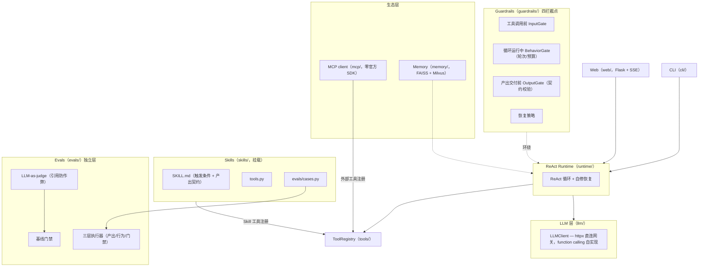

# Sluice

**A Skill-Mountable Data Agent Platform with a Self-Built ReAct Harness**

[](https://github.com/JohnnyQ-commits/sluice-data-agent/actions/workflows/ci.yml)
[](pyproject.toml)
[](LICENSE)
[](#status)

[English](#overview) | [中文](#概览)

## Overview

Sluice is a business-agnostic agent runtime for data work. It is not a single agent — it is a platform: mount a Skill package (`SKILL.md` + `tools.py` + `evals/`), and you immediately get a ReAct loop wrapped by guardrails at four interception points (before each tool call, during the loop, before delivery, and at recovery), an LLM-as-judge eval gate that rejects scores not backed by verbatim quotes from the output, audit logging for every run, a zero-official-SDK MCP client for the tool ecosystem, and FAISS-backed long-term memory.

We self-built the harness deliberately. The production-critical control points — where to intercept a hallucinated tool call, how to classify and recover from LLM failures, how to gate quality with deterministic plus judge-layer evals — are exactly the parts that general frameworks keep inside their black box. In Sluice, all of them live in small single-file modules — the largest is ~330 lines — that you can read end to end.

The LLM layer is httpx straight to any Anthropic-Messages-compatible gateway — no official SDK, function calling implemented by hand. Evals run in three layers (outcome / behavior / guardrail), and the whole suite passes without any API key.

## 概览

**Sluice 是一个可挂载 Skill 的数据 Agent 平台，核心是一套自研 ReAct harness。** 它是业务无关的运行时——数据 Skill 只是第一批乘客，任何满足包协议的 Skill 都能挂载并获得平台全部能力。

五阶段演进（每阶段都有完整实现计划，见 `docs/plans/`）：

| 阶段 | 主题 | 交付 |
|------|------|------|
| P0 | 骨架 | 包结构 / 配置 / 异常体系 |
| P1 | 核心闭环 | SQLite 工具 / Skill 协议 / Web SSE |
| P2 | 可靠性 | guardrails 四拦截点 / 审计 / 自修恢复（E2E demo 环境实测拦截幻觉表） |
| P3 | 评测层 | 三层执行器 / judge 引用防作弊 / 基线门禁 |
| P4 | 生态层 | MCP 三件套零官方 SDK 自实现 / memory 层 FAISS+Milvus / LangGraph 对比移植 |

核心特性：

- **自研 ReAct harness**：循环、轨迹、自修恢复全部自己持有，四个 guardrail 拦截点（工具调用前 / 循环运行中 / 产出交付前 / 恢复策略）内建于发动机
- **Skill 包协议**：`SKILL.md`（frontmatter 声明触发条件与产出契约）+ `tools.py` + `evals/cases.py` 三件套，挂载即获得评测与门禁
- **LLM-as-judge 防作弊**：judge 每项评分必须引用产出原文逐字佐证，引用归一化比对不通过则判分无效
- **零官方 LLM SDK**：httpx 直连任意 Anthropic-Messages 兼容网关，function calling 协议自实现
- **零官方 SDK 的 MCP client**：protocol / transport / registry 三件套自实现，读 `.mcp.json` 接入工具生态
- **长期记忆**：FAISS 本地向量检索，可选 Milvus 后端
- **零 API key 可跑全量测试**：275 个测试，CI 持续验证

## Why self-built (not LangChain)?

生产命门在框架黑盒里拿不到：guardrails 该在循环的哪几个点拦截、LLM 异常如何分类并决定重试还是放弃、评测怎么做三层才能既确定性又防作弊——这些是可靠性问题的答案本身，而不是框架的配置项。拿不到控制点，就只能围着别人的抽象打补丁。

我们不排斥框架，而是先验证了边界：`examples/langgraph_weekly/` 是同一个周报 Skill 的 LangGraph 对比移植，可以逐行对比两边各控制住了什么、让渡了什么。

## Quickstart

```bash
git clone https://github.com/JohnnyQ-commits/sluice-data-agent.git
cd sluice-data-agent
pip install -e ".[dev]"

# 全量测试：275 passed，零 API key
pytest tests/ -q

# 配置 LLM 网关后解锁真实调用（Anthropic Messages 兼容端点均可）
cp .env.example .env   # 填 SLUICE_LLM_BASE_URL / SLUICE_LLM_API_KEY / SLUICE_LLM_MODEL

# 单次指令跑完整 ReAct 循环并打印轨迹（内置 demo 库 data/demo.db）
sluice run "生成本周销售周报"

# 本地 Web 壳（Flask + SSE）
sluice web

# 评测门禁：全部 Skill 三层评测
sluice eval --all

# MCP 工具生态：列出工具 / 调用指定工具
# 前提：仓库根有 .mcp.json（sluice mcp 直接读该文件）；Web 运行时接入 MCP 工具还需 .env 设 SLUICE_MCP_ENABLED=true
sluice mcp
sluice mcp --call <tool_name> --args '{}'
```

`.mcp.json` 形状示例（stdio server；仓库自带一个最小 echo server `tests/fixtures/mini_mcp_server.py`，照此配置即可 `sluice mcp --call mcp__echo__echo --args '{"text": "hi"}'`）：

```json
{
  "mcpServers": {
    "echo": {
      "command": "python",
      "args": ["tests/fixtures/mini_mcp_server.py"],
      "timeout": 30
    }
  }
}
```

## MCP 生态

Sluice 不锁工具生态：stdio 接入任意 MCP server，工具以 `mcp__<server>__<tool>` 命名挂进 ReAct 循环与 `sluice mcp`，公共 server 开箱即用。仓库提供 `.mcp.json.example`（公共 filesystem server，复制为 `.mcp.json` 即生效）：

```json
{
  "mcpServers": {
    "filesystem": {
      "command": "cmd",
      "args": ["/c", "npx", "-y", "@modelcontextprotocol/server-filesystem", "examples"],
      "timeout": 120
    }
  }
}
```

实测两条命令（Windows 下 Popen 不解析 `npx` 的 `.cmd` shim 故包一层 `cmd /c`，POSIX 直接写 `"command": "npx"`；`timeout` 需覆盖 npx 冷启动的 30s+）：

```bash
sluice mcp   # 列出 14 个工具（read_file / edit_file / directory_tree / ...）
sluice mcp --call mcp__filesystem__read_file --args '{"path": "langgraph_weekly/README.md"}'
```

## Architecture



各模块一句话职责：

- `llm/` — httpx 直连 Anthropic Messages 兼容网关，超时重试与 function calling 协议自实现
- `tools/` — 原子工具与注册表（SQLite 查询、echo 等），Skill 工具与 MCP 工具共用一个 registry
- `skills/` — Skill 包加载器与两个内置示例 Skill（`weekly-report`、`credit-weekly`）
- `runtime/` — ReAct 循环发动机：多轮 thought→action→observation、轨迹记录、异常分类与自修恢复
- `guardrails/` — 四拦截点编排：工具调用前、循环运行中（轮次/Token 预算）、产出交付前、恢复策略；`guardrails=None` 即回退到裸循环
- `evals/` — 三层执行器 + LLM-as-judge（逐项引用产出原文佐证，引用不到即判分无效）+ 基线回归门禁
- `mcp/` — 零官方 SDK 的 MCP client 三件套（protocol/transport/registry），读 `.mcp.json` 发现并调用外部工具
- `memory/` — 会话记忆与长期记忆（FAISS 本地检索，可选 Milvus 后端）
- `web/` — Flask + SSE 的本地 Web 壳
- `cli/` — `run` / `web` / `eval` / `mcp` 四个子命令入口
- `config/` / `exceptions.py` — pydantic-settings 配置与异常体系

## Skill 包协议

一个 Skill 包 = 三件套，目录名即 Skill 名：

```
skills/weekly-report/
├── SKILL.md        # frontmatter: name / description / output_contract（产出契约小节清单）+ 正文写死统计口径与使用流程
├── config.yaml     # Skill 包配置
├── tools.py        # Skill 专属工具，函数名以 {skill}.{tool} 前缀注册进 ToolRegistry
└── evals/
    └── cases.py    # 三层评测用例：产出断言 / 行为断言 / 门禁
```

平台对挂载的 Skill 兑现三件事：工具进 registry 参与 ReAct 循环；`SKILL.md` 的 `output_contract` 自动成为产出交付前的门禁校验项；`evals/cases.py` 被 `sluice eval` 纳入三层评测与基线门禁。

参考实现：[`skills/weekly-report/`](skills/weekly-report/)。

## Status

**alpha**。核心闭环、可靠性、评测、生态四层均已落地并有全量测试（275 tests）与 CI 门禁，API 仍可能变化。

工程过程即文档：`docs/plans/` 保留 P0–P4 五个阶段的完整实现计划（含执行红线），另有 P5 发布收口计划，可以完整复盘每层是怎么一步步建起来的。

## License

[MIT](LICENSE)
